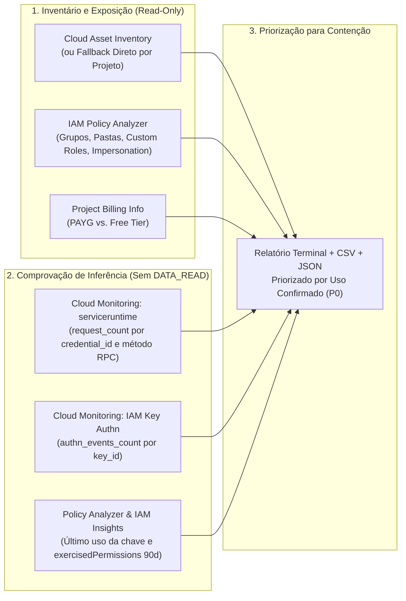

# GCP LLMJacking Credential Audit Toolkit

> [!WARNING]
> **Aviso Importante — Ferramenta Não Oficial ("As-Is"):** Este repositório contém utilitários de referência independentes, fornecidos "no estado em que se encontram" (*as-is*), **sem vínculo com produtos oficiais e sem garantia ou suporte técnico do Google Cloud**. Seu objetivo exclusivo é apoiar equipes de Resposta a Incidentes (CSIRT/SecOps) e Cloud Engineering na **auditoria rápida e somente leitura (*read-only*)** durante uma suspeita de vazamento de credenciais estáticas. Nenhuma alteração, bloqueio ou exclusão de recursos é executada automaticamente pelos scripts.

---

## 1. Contexto e Objetivo

Em incidentes de **LLMJacking** (uso não autorizado de cotas de modelos generativos por meio de credenciais estáticas vazadas), o tempo de triagem é decisivo para estancar custos inesperados (*Denial of Wallet*). Em ambientes Google Cloud, as equipes de resposta costumam enfrentar três dificuldades imediatas:

1. **Pontos cegos na hierarquia IAM:** Uma *Service Account Key* vazada pode residir em um projeto auxiliar (ex.: CI/CD sem APIs de IA habilitadas), mas alcançar projetos produtivos por herança de Organização/Pasta, participação em *Google Groups*, *Custom Roles* ou cadeias de *Impersonation* (`TokenCreator` / `actAs`).
2. **API Keys antigas ou irrestritas:** Projetos com `generativelanguage.googleapis.com` (Google AI Studio / Gemini Developer API) vinculada a uma conta de faturamento ativa (*Pay-As-You-Go*) podem conter *API Keys* sem restrição de serviço ou de endereço IP.
3. **Ausência de logs `DATA_READ`:** Métodos de inferência (`:generateContent`, `:streamGenerateContent`, `:predict`, `:rawPredict`) são classificados como `DATA_READ` no Cloud Audit Logs e permanecem desabilitados por padrão. Ativá-los após a detecção do incidente não recupera o histórico retroativo do ataque.

Este repositório reúne dois scripts em **Python 3 padrão + `gcloud` CLI** (sem dependências externas `pip`, prontos para execução imediata no **Google Cloud Shell**):

| Script | Plataforma Alvo | API Auditada | Credencial Analisada |
| :--- | :--- | :--- | :--- |
| **`audit_agent_platform_sa_keys.py`** | **Gemini Enterprise Agent Platform** *(antigo Vertex AI)* | `aiplatform.googleapis.com` | Chaves estáticas `USER_MANAGED` de *Service Accounts* |
| **`audit_genai_api_keys.py`** | **Gemini Developer API / Google AI Studio** *(e Agent Platform Express)* | `generativelanguage.googleapis.com` *(+ opcional `aiplatform.googleapis.com`)* | *API Keys* (`apikeys.googleapis.com/Key`), incluindo chaves irrestritas e chaves vinculadas a SA |

---

## 2. Arquitetura de Coleta (100% Somente Leitura e Sem `DATA_READ`)

Os utilitários correlacionam inventário, permissões efetivas e métricas nativas gratuitas habilitadas por padrão no Google Cloud (com retenção retroativa de até **6 semanas / 42 dias** no Cloud Monitoring e **90 dias** no Policy Analyzer / IAM Insights):



### Como o uso real de inferência é comprovado sem `DATA_READ`?

* **Contagem exata de chamadas de inferência (`serviceruntime.googleapis.com/api/request_count`):** Registra no recurso `consumed_api` o método RPC exato (`GenerateContent`, `StreamGenerateContent`, `RawPredict`, `Predict`, `CreateBatchPredictionJob`), a classe HTTP (`2xx` vs. `4xx`/`429`) e o identificador não sensível da credencial:
  * Service Accounts: `credential_id = "serviceaccount:<SA_UNIQUE_ID>"`
  * API Keys: `credential_id = "apikey:<KEY_UID>"`
* **Isolamento de `key_id` específica (`iam.googleapis.com/service_account/key/authn_events_count` + Policy Analyzer):** Quando uma mesma Service Account possui mais de uma chave `.json` (ou também executa workloads legítimos via GCE/GKE Workload Identity), contabiliza quantas autenticações cada `key_id` realizou na janela analisada.

> [!NOTE]
> **Por que existe o status `SA_ACTIVE_VERIFY_KEY`?** A métrica que conta chamadas ao Gemini Enterprise Agent Platform (Vertex AI) atualiza em **~2 minutos**, mas informa apenas **qual Service Account** fez as chamadas (sem dizer qual arquivo `.json` foi usado). Já a métrica do IAM que informa **qual chave `.json` específica (`key_id`)** fez login leva de **1 a 3 horas** para consolidar eventos recentes. Por isso, quando a Service Account já aparece fazendo chamadas reais de IA, mas a chave `.json` ainda marca zero autenticações, o script alerta imediatamente no topo como **`SA_ACTIVE_VERIFY_KEY` (`P0`)** — indicando **(a) um ataque muito recente (< 3h)** em que o relatório da chave ainda não fechou, ou **(b) que essa SA roda legitimamente dentro do GCP sem chave `.json`** (ex.: GKE, Cloud Run ou VM) e possui uma chave `.json` antiga esquecida na conta.

---

## 3. Escopo de Testes Validados e Limitações

### 3.1 Cenários Cobertos e Validados

| Vetor / Cenário | `audit_agent_platform_sa_keys.py` | `audit_genai_api_keys.py` | Comportamento Validado |
| :--- | :---: | :---: | :--- |
| **Permissão direta em projeto com IA habilitada** | Sim | Sim | Identifica chaves `USER_MANAGED` (`aiplatform.endpoints.predict` / `batchPredictionJobs.create`) e API Keys explícitas para `generativelanguage.googleapis.com`. |
| **Múltiplas chaves na mesma Service Account** | Sim | N/A | Separa a chave efetivamente utilizada (`CONFIRMED_KEY_INFERENCE`) de chaves irmãs ociosas (`SA_INFERENCE_KEY_IDLE`). |
| **Service Account Cross-Project (origem sem IA ativa)** | Sim | N/A | Detecta chaves criadas em projetos sem `aiplatform.googleapis.com` habilitado que possuem permissão sobre projetos onde a plataforma está ativa. |
| **Herança de Organização/Pasta, Google Groups e Custom Roles** | Sim | N/A | Avalia políticas herdadas, expande membros de grupos (`--expand-groups`) e inspeciona permissões internas de *Custom Roles*. |
| **Cadeias de Impersonation (`TokenCreator` / `actAs`)** | Sim (`--include-impersonation`) | N/A | Detecta chaves em SAs intermediárias sem acesso direto à IA que podem gerar token para outra SA com acesso, isolando papéis amplos (`roles/editor`) para não inflar contagens. |
| **IAM Conditions (CEL) e Chaves Desabilitadas/Expiradas** | Sim | N/A | Extrai expressões CEL do binding e classifica chaves inativas como `LOW_DISABLED_KEY` / `LOW_EXPIRED_KEY`. |
| **API Keys Irrestritas (`apiTargets` vazio)** | N/A | Sim | Alerta chaves antigas sem restrição de API (`UNRESTRICTED_ALL_APIS`) hospedadas em projetos onde `generativelanguage.googleapis.com` foi habilitado. |
| **Correlação com Faturamento (`PAYG` vs. *Free Tier*)** | N/A | Sim | Cruza `ProjectBillingInfo` para priorizar chaves abertas (`OPEN_ANY_IP_OR_APP`) em projetos com *Billing* ativo (`CRITICAL_PAYG_OPEN_KEY`). |
| **Exclusão de Papéis / Chaves Sem Acesso de Inferência** | Sim | Sim | Ignora papéis apenas de leitura (ex.: `roles/aiplatform.viewer`), chaves `SYSTEM_MANAGED`, Service Agents do Google e API Keys restritas exclusivamente a outras APIs. |

### 3.2 Limitações Conhecidas (Fora do Escopo)

* **Credenciais humanas ou federação externa sem chaves estáticas:** Tokens OAuth de usuários (`user:...`) comprometidos ou provedores de *Workload Identity Federation* mal configurados não utilizam `ServiceAccountKey` nem `API Key`.
* **Endereço IP de origem (`callerIp`) e `User-Agent`:** As métricas nativas confirmam **qual chave**, **qual projeto**, **quais métodos** e **quantas chamadas** ocorreram, o que é suficiente para contenção imediata. A atribuição de IP público por requisição exige logs `DATA_READ` habilitados previamente (ou habilitados temporariamente por alguns minutos antes da desativação da chave comprometida).

---

## 4. Pré-requisitos, Permissões IAM e Cotas (Com e Sem SCC Premium)

Requisitos: **Python 3.8+** e **Google Cloud CLI (`gcloud`)** autenticado (ambos nativos no Google Cloud Shell).

### Permissões IAM recomendadas (Somente Leitura)

* **Modo `cai` (Recomendado — varredura rápida em nível de Organização ou Pasta):**
  * APIs habilitadas no projeto informado em `--billing-project`: `cloudasset.googleapis.com`, `monitoring.googleapis.com` e (opcionalmente) `policyanalyzer.googleapis.com` e `recommender.googleapis.com`.
  * Papéis na Organização/Pasta: `roles/cloudasset.viewer` e `roles/monitoring.viewer` *(opcionais para enriquecimento: `roles/policyanalyzer.activityAnalysisViewer`, `roles/recommender.iamViewer` e `roles/billing.viewer`)*.
* **Modo `direct` (Fallback direto por projeto):**
  * `roles/iam.securityReviewer`, `roles/serviceusage.serviceUsageViewer`, `roles/serviceusage.apiKeysViewer` e `roles/monitoring.viewer`.

### Impacto de Cotas sem Security Command Center (SCC) Premium/Enterprise

| API Utilizada | Cota sem SCC Premium/Enterprise | Impacto nos Scripts |
| :--- | :--- | :--- |
| **`AnalyzeIamPolicy`** (`analyze-iam-policy`) | **20 queries / dia / Organização** | Ao rodar com `--org SEU_ORG_ID`, `audit_agent_platform_sa_keys.py` consome **apenas 1 query** para varrer a organização inteira. Caso as 20 queries diárias já tenham sido esgotadas (`RESOURCE_EXHAUSTED`), o script faz **fallback automático** para `search-all-iam-policies` (400 req/min gratuitos). |
| **`SearchAllResources` / `SearchAllIamPolicies`** | **400 req/min** (gratuito) | Zero restrição de SCC (`audit_genai_api_keys.py` inteiro usa apenas chamadas livres dessa cota). |
| **`serviceAccountKeyLastAuthentication`** | **Isento do limite de 20/dia** | Consulta de último uso de chaves não consome a cota diária do Policy Analyzer. |
| **Cloud Monitoring** (`serviceruntime` + `key/authn`) | **Gratuito / Padrão** | A comprovação real de chamadas de inferência das últimas 6 semanas funciona integralmente sem SCC. |

---

## 5. Como Executar

### 5.1 Service Account Keys no Gemini Enterprise Agent Platform / Vertex AI (`audit_agent_platform_sa_keys.py`)

```bash
# 1. Varredura completa na Organização incluindo cadeias de Impersonation (Recomendado):
python3 audit_agent_platform_sa_keys.py \
  --org SEU_ORG_ID \
  --lookback-days 14 \
  --include-impersonation \
  --active-keys-only \
  --billing-project PROJETO_QUOTA_SECOPS

# 2. Filtrar APENAS chaves com chamadas reais de inferência detectadas na janela (Foco P0):
python3 audit_agent_platform_sa_keys.py \
  --org SEU_ORG_ID \
  --lookback-days 30 \
  --include-impersonation \
  --only-confirmed-inference \
  --billing-project PROJETO_QUOTA_SECOPS

# 3. Modo Fallback Direto (sem Cloud Asset Inventory, varrendo projetos visíveis):
python3 audit_agent_platform_sa_keys.py \
  --all-accessible-projects \
  --mode direct \
  --lookback-days 14 \
  --active-keys-only
```

### 5.2 API Keys no Gemini Developer API / AI Studio (`audit_genai_api_keys.py`)

```bash
# 1. Varredura na Organização (incluindo Agent Platform / Vertex Express Mode):
python3 audit_genai_api_keys.py \
  --org SEU_ORG_ID \
  --lookback-days 14 \
  --include-vertex-express \
  --billing-project PROJETO_QUOTA_SECOPS

# 2. Modo Fallback Direto em lista de projetos específicos:
python3 audit_genai_api_keys.py \
  --projects projeto-app-1,projeto-ia-2 \
  --mode direct \
  --lookback-days 14
```

---

## 6. Interpretando os Resultados e Contenção Reversível

### 6.1 Classificações do `audit_agent_platform_sa_keys.py`

| `inference_activity_status` | Prioridade | Significado Operacional | Ação Recomendada |
| :--- | :---: | :--- | :--- |
| **`CONFIRMED_KEY_INFERENCE`** | **P0** | A SA realizou chamadas reais de inferência **e** esta `key_id` específica autenticou no período. | Validar legitimidade; se desconhecida, **desabilitar na hora** (`keys disable`). |
| **`SA_ACTIVE_VERIFY_KEY`** | **P0** | A SA registra chamadas reais de inferência, mas a chave `.json` ainda marca zero logins — indica **(a) ataque iniciado há < 3h** ou **(b) SA usada por GKE/Cloud Run/VM** com uma chave `.json` antiga esquecida. | Se o consumo for desconhecido, desabilitar na hora (`keys disable`). Se houver GKE/Cloud Run/VM legítimo usando a SA, desabilitar a chave `.json` órfã também é seguro (não derruba identidade anexada). |
| **`SA_INFERENCE_KEY_IDLE`** | **P1** | A SA faz inferência por meio de **outra** chave ativa na mesma conta, enquanto esta `key_id` teve zero autenticações. | Concentrar contenção na chave irmã ativa e agendar remoção desta chave ociosa. |
| **`KEY_AUTH_NO_INFERENCE`** | **P2** | A chave autentica em outras APIs (ex.: Storage/BigQuery em SA `Editor`), mas fez **zero** chamadas de inferência. | Remover permissão `aiplatform` (menor privilégio) sem interromper o pipeline. |
| **`DORMANT_NO_ACTIVITY`** | **P3** | Chave ativa com permissão de inferência, sem autenticações nem chamadas recentes. | Desabilitar preventivamente para reduzir superfície de exposição. |

### 6.2 Classificações do `audit_genai_api_keys.py`

| `risk_status` | Significado Operacional | Ação Recomendada |
| :--- | :--- | :--- |
| **`P0_ACTIVE_API_KEY_DOING_INFERENCE`** | API Key com chamadas reais de geração/inferência registradas no período (`apikey:<UID>`). | Confirmar origem do consumo; se anômalo, aplicar restrição de contenção imediata. |
| **`CRITICAL_PAYG_OPEN_KEY`** | Projeto com **Billing ativo (`TRUE`)** e API Key **sem restrição de IP/App** (explícita ou irrestrita). | Restringir imediatamente por IP/Referrer/App e `apiTargets`, ou revogar. |
| **`MODERATE_CLIENT_RESTRICTED_KEY`** | API Key possui restrição configurada de IP, HTTP Referrer ou App Android/iOS. | Revisar se os endereços/domínios seguem privilégio mínimo. |
| **`MEDIUM_FREE_TIER_KEY`** | Projeto sem conta de faturamento ativa vinculada (*Free Tier*). | Menor risco financeiro direto; aplicar restrições ou excluir chaves sem uso. |

### 6.3 Comandos de Contenção Rápida e Reversível

> [!TIP]
> Prefira ações de **bloqueio reversível** antes da exclusão definitiva: elas estancam o consumo imediatamente e permitem restauração rápida caso alguma aplicação legítima seja impactada.

```bash
# 1. Service Account Keys — Desabilitar antes de excluir:
gcloud iam service-accounts keys disable <KEY_ID> \
  --iam-account=<SA_EMAIL> \
  --project=<SA_PROJECT_ID>

# 2. API Keys — Restringir a loopback (127.0.0.1) ou excluir (reversível por 30d via `undelete`):
gcloud services api-keys update projects/<PROJECT_ID>/locations/global/keys/<KEY_UID> \
  --allowed-ips=127.0.0.1
```

---

## 7. Executando os Testes Unitários

```bash
python3 -m unittest discover -s tests -v
```

## Licença

Distribuído sob a licença [Apache 2.0](LICENSE).
